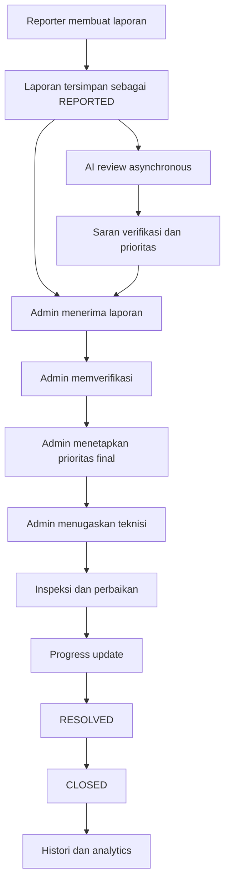
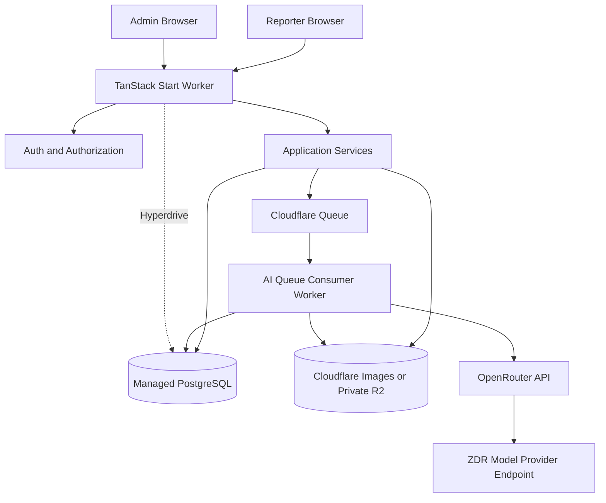
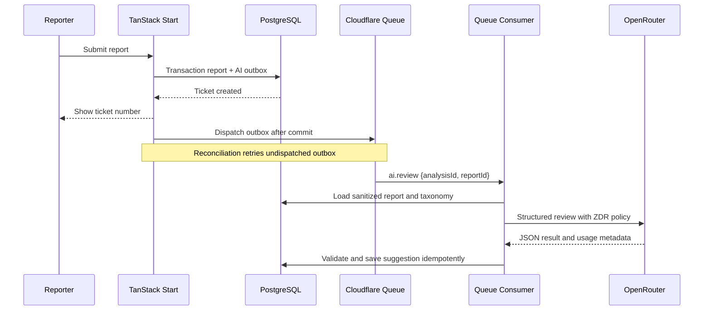
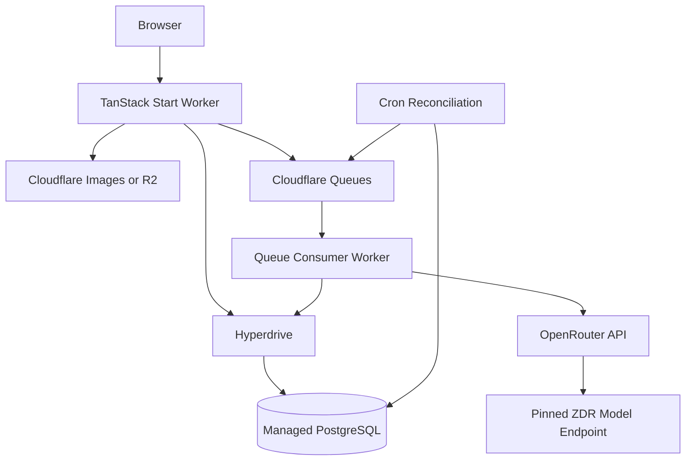

# Execution Plan — Smart Campus Maintenance System

> **Relasi dokumen:** PRD (`Tugas-Tugas Semester 7.md`) menjelaskan kebutuhan produk; `docs/decisions/PHASE-0-PRODUCT-DECISIONS.md` menjadi sumber kebenaran keputusan produk/operasional; dokumen ini menerjemahkan keduanya menjadi rencana teknis. Nilai yang masih `TBD` pada Phase 0 belum boleh diperlakukan sebagai keputusan final.

## 1. Tujuan Dokumen

Dokumen ini menerjemahkan PRD **Smart Campus Maintenance System UPI Kampus Tasikmalaya** menjadi panduan implementasi MVP yang dapat dieksekusi secara bertahap.

Execution plan ini berfokus pada:

1. membangun alur maintenance yang lengkap dari laporan sampai penutupan;
2. memastikan reporter memperoleh transparansi progres;
3. memastikan admin dapat mengelola laporan, fasilitas, teknisi, dan histori;
4. menyediakan analytics operasional yang konsisten;
5. menambahkan AI sebagai **decision support**, bukan pengambil keputusan;
6. menghasilkan prototype yang aman, dapat diuji, dan dapat dikembangkan lebih lanjut.

---

## 2. Ringkasan Produk yang Akan Dibangun

Sistem memiliki dua area utama:

- **Reporter portal** untuk membuat laporan kerusakan, mengunggah foto, memperoleh ticket ID, melacak progres, menerima notifikasi, dan melihat status fasilitas kampus.
- **Admin portal** untuk memverifikasi laporan, menetapkan klasifikasi dan prioritas final, menugaskan teknisi, memperbarui status/progres, mengelola master data fasilitas, serta melihat histori dan analytics.

AI berjalan setelah laporan tersimpan dan menghasilkan rekomendasi untuk membantu admin:

- indikasi validitas laporan dan potensi duplikat sebagai sinyal review;
- prioritas yang disarankan beserta faktor risiko/dampak;
- alasan singkat untuk membantu verifikasi.

AI tidak menentukan kategori/issue type final, tidak mengubah status, dan tidak menandai duplikat secara otomatis. Hasil AI harus selalu dipisahkan dari keputusan final admin.



---

## 3. Prinsip Implementasi

1. **Core workflow harus tetap berfungsi tanpa AI.** Kegagalan provider AI tidak boleh menggagalkan pembuatan atau pengelolaan laporan.
2. **Authorization diterapkan di server.** Menyembunyikan tombol pada UI tidak cukup.
3. **Timeline dan audit bersifat append-only.** Histori tidak boleh hilang saat nilai terbaru berubah.
4. **State transition eksplisit.** Status tidak boleh diubah secara bebas tanpa validasi aturan transisi.
5. **AI suggestion tidak sama dengan final decision.** Nilai saran dan nilai final disimpan pada field/record berbeda.
6. **Status fasilitas diturunkan dari laporan aktif.** Hindari dua sumber kebenaran yang dapat tidak sinkron.
7. **Gunakan master data terstruktur.** Lokasi, kategori, issue type, fasilitas, dan teknisi tidak dibuat sebagai free text pada setiap laporan.
8. **Mulai dari vertical slice.** Selesaikan satu alur reporter–admin end-to-end sebelum menambah analytics dan AI.
9. **MVP tetap modular.** Gunakan modular monolith, bukan microservices, tetapi pisahkan domain dan integrasi eksternal melalui interface.
10. **Setiap phase memiliki release gate.** Phase berikutnya dimulai setelah acceptance criteria phase sebelumnya terpenuhi.

---

## 4. Register Keputusan Produk dan Baseline Sementara

PRD sudah menjelaskan tujuan dan fitur. Keputusan final dicatat pada `docs/decisions/PHASE-0-PRODUCT-DECISIONS.md`; bagian di bawah ini menjelaskan keputusan yang sudah ada dan baseline sementara untuk hal yang masih menunggu approval.

### 4.1 Authentication dan provisioning akun

Keputusan Phase 0 (pilot lokal, 2026-10-10):

- seluruh environment memakai `MockSsoProvider`; integrasi `UpiSsoProvider` ditunda;
- guard penolakan `AUTH_PROVIDER=mock` di production dinonaktifkan selama pilot;
- provider mengembalikan identity terverifikasi (termasuk NIM bila tersedia), role, dan status akun aktif;
- role hanya `REPORTER` dan `ADMIN`;
- tidak ada public self-registration atau password lokal sebagai pengganti SSO;
- session cookie dan authorization server-side tetap wajib;
- pilot production wajib akses terbatas; migrasi ke SSO UPI sebelum dibuka publik.

Detail dan status approval tetap mengikuti decision register.

### 4.2 Lifecycle dan transisi status

PRD mendefinisikan:

`REPORTED → VERIFIED → ASSIGNED → INSPECTION → IN_REPAIR → RESOLVED → CLOSED`

Namun contoh end-to-end melewati `INSPECTION`. Keputusan ini harus dibuat eksplisit.

**Rekomendasi canonical workflow:**

| Current status | Allowed next status | Syarat minimum |
|---|---|---|
| `REPORTED` | `VERIFIED`, `REJECTED`, `DUPLICATE` | Admin meninjau isi laporan |
| `VERIFIED` | `ASSIGNED` | Kategori, issue type, asset/lokasi, dan priority final sudah ditetapkan |
| `ASSIGNED` | `INSPECTION` | Teknisi aktif sudah ditugaskan |
| `INSPECTION` | `IN_REPAIR`, `RESOLVED` | Admin mencatat hasil inspeksi |
| `IN_REPAIR` | `RESOLVED` | Admin menambahkan resolution note |
| `RESOLVED` | `CLOSED`, `IN_REPAIR` | Tutup atau reopen jika masalah belum selesai |
| `CLOSED` | — | Terminal |
| `REJECTED` | — | Terminal; alasan wajib |
| `DUPLICATE` | — | Terminal; referensi ticket utama wajib |

Catatan:

- `REJECTED` dan `DUPLICATE` tidak disebut sebagai lifecycle utama dalam PRD, tetapi diperlukan agar proses verifikasi memiliki hasil yang lengkap.
- Jika scope harus sangat ketat, kedua status tersebut dapat ditunda, tetapi admin tetap memerlukan mekanisme penanganan laporan tidak valid.
- `RESOLVED` berarti perbaikan dinyatakan selesai, sedangkan `CLOSED` berarti tiket telah diarsipkan secara final.
- Untuk MVP, penutupan dilakukan admin. Konfirmasi penutupan oleh reporter dapat menjadi fase berikutnya.

### 4.3 Duplicate report

Sistem harus mencegah reporter membuat laporan berulang untuk insiden yang sama, tetapi tidak boleh menganggap semua laporan pada fasilitas yang sama sebagai duplikat.

Bedakan dua mekanisme:

- **Idempotency:** `idempotencyKey` mencegah double-click atau retry request membuat ticket kedua.
- **Duplicate detection:** sistem mencari laporan aktif yang kemungkinan merujuk pada insiden yang sama.

Laporan menjadi kandidat duplikat jika memenuhi kombinasi berikut:

- reporter/NIM yang sama;
- asset atau lokasi yang sama;
- kategori dan issue type yang sama;
- laporan sebelumnya masih aktif;
- berada dalam jendela waktu yang dikonfigurasi, dengan lookback default 14 hari untuk efisiensi pencarian.

Lookback tidak boleh mencegah deteksi jika laporan aktif yang memenuhi kriteria ditemukan di luar jangka tersebut. Deskripsi bukan penentu utama; sistem dapat menormalisasi dan membandingkannya sebagai sinyal pendukung, tetapi deskripsi saja tidak cukup untuk menetapkan duplikat.

Jika kandidat ditemukan, reporter diberi pilihan untuk membuka ticket yang sudah ada. Sistem tidak langsung memblokir submit. Admin dapat mengonfirmasi melalui `markDuplicate(reportId, canonicalReportId, expectedVersion)`. Laporan yang sudah `CLOSED` tidak menjadi penghalang laporan baru karena kerusakan dapat terjadi kembali.

Laporan dari reporter berbeda yang merujuk pada fasilitas dan issue yang sama tidak dianggap duplikat. Laporan tersebut tetap disimpan sebagai laporan pendukung/related report dan dapat ditautkan admin ke ticket utama. Jumlah reporter berbeda dapat digunakan sebagai indikator dampak dan frekuensi, tanpa membuat pekerjaan perbaikan ganda.

Aturan ini harus menggunakan `reporter_id` yang terhubung ke akun/NIM terverifikasi, bukan NIM yang diketik bebas pada deskripsi laporan.

### 4.4 Priority

> **Status:** dimensi dan safety rule sudah diputuskan pada Phase 0; angka bobot dan ambang di bawah adalah baseline provisional untuk spike/test. Jangan dipromosikan menjadi aturan operasional sebelum disetujui UMPER/admin.

Gunakan enum:

- `LOW`
- `MEDIUM`
- `HIGH`

Tidak ada level `CRITICAL`.

Simpan secara terpisah:

- `priorityScore` deterministik beserta snapshot faktor (`priorityFactors`);
- `suggestedPriority` dari mapping skor;
- `aiSuggestedPriority` dari AI (independen, tidak menimpa skor);
- `finalPriority`;
- `priorityOverrideReason`, jika keputusan admin berbeda dari saran;
- `priorityDecidedBy` dan `priorityDecidedAt`;
- `scoringConfigVersion`.

UMPER/admin menentukan rubric, bobot, dan aturan override pada Phase 0. **Sistem menghitung skor secara deterministik dari master data; AI tidak menjadi sumber perhitungan final dan tidak menetapkan bobot.** AI hanya membantu mengekstrak risiko/dampak dari deskripsi dan mengisi `aiSuggestedPriority`.

Gunakan skor 0–100:

| Komponen | Bobot maksimum | Penentu |
|---|---:|---|
| Bobot kategori aset | 40 | Master data kategori oleh admin |
| Bobot aset/fasilitas | 30 | Master data fasilitas oleh admin |
| Bobot lokasi (frekuensi kuliah) | 30 | Master data lokasi; tier provisional sampai jadwal resmi tersedia |

`score = kategori + aset + lokasi` (integer 0–100).

Pemetaan skor (baseline provisional):

| Skor | Priority |
|---:|---|
| 0–39 | `LOW` |
| 40–69 | `MEDIUM` |
| 70–100 | `HIGH` |

Bobot belum tersedia memakai default median (kategori 20, aset 15, lokasi 15) dengan flag `scoringComplete = false`; admin wajib menetapkan `finalPriority` manual. Perubahan konfigurasi bobot/ambang menaikkan `scoringConfigVersion` dan hanya berlaku untuk laporan baru; laporan lama tidak dihitung ulang.

Aturan minimum (diputuskan):

- issue type `DANGEROUS` menghasilkan minimal `HIGH`;
- admin boleh menaikkan atau menurunkan hasil, tetapi wajib mengisi `priorityOverrideReason` bila berbeda dari saran.

Contoh rubric awal:

| Priority | Indikasi |
|---|---|
| `HIGH` | Menghambat kegiatan pada ruang/fasilitas penting dan perlu ditangani segera, atau berpotensi membahayakan |
| `MEDIUM` | Mengganggu penggunaan tetapi masih tersedia workaround |
| `LOW` | Kerusakan minor atau kosmetik tanpa dampak operasional langsung |

### 4.5 Asset dan lokasi

**Baseline sementara, menunggu keputusan taxonomy Phase 0:**

- reporter memilih gedung, ruang/lokasi, kategori, dan asset jika dikenali;
- reporter dapat memilih “asset tidak ditemukan” agar laporan tetap bisa dibuat;
- admin wajib menautkan atau membuat asset sebelum laporan menjadi `VERIFIED`;
- kategori, lokasi, asset, dan issue type berasal dari master data;
- issue type difilter berdasarkan kategori.

### 4.6 Facility status

Status fasilitas publik tidak diedit sebagai sumber kebenaran terpisah. Status diturunkan dari laporan aktif:

| Kondisi laporan aktif | Status fasilitas publik |
|---|---|
| Tidak ada laporan aktif | `OPERATIONAL` |
| Ada laporan `REPORTED` atau `VERIFIED` | `REPORTED_ISSUE` |
| Ada laporan `ASSIGNED` atau `INSPECTION` | `UNDER_INSPECTION` |
| Ada laporan `IN_REPAIR` | `IN_REPAIR` |

Jika satu asset memiliki beberapa laporan aktif, pilih status dengan severity operasional tertinggi: `IN_REPAIR` > `UNDER_INSPECTION` > `REPORTED_ISSUE`.

### 4.7 Progress update dan visibilitas

Bedakan dua jenis catatan:

- **Public update:** dapat dibaca reporter pemilik tiket;
- **Internal note:** hanya admin.

Keduanya append-only. Jika ada koreksi, buat catatan baru; jangan menghapus histori lama tanpa prosedur audit khusus.

### 4.8 Assignment teknisi

**Rekomendasi MVP:**

- satu teknisi aktif pada satu waktu untuk setiap tiket;
- reassignment diperbolehkan dan historinya disimpan;
- teknisi tidak mempunyai akun;
- semua tindakan pada sistem tetap tercatat dilakukan oleh admin;
- reporter hanya melihat nama tampilan teknisi, tanpa nomor telepon atau data pribadi lain.

### 4.9 Kebijakan upload

Kebijakan berikut sudah dicatat sebagai keputusan Phase 0 dan menjadi baseline MVP:

MVP hanya menerima gambar, bukan video.

Baseline:

- format: JPEG, PNG, WebP;
- maksimal 5 MB per file;
- maksimal 3 file per laporan;
- SVG, executable, dan file dengan MIME palsu ditolak;
- validasi extension, MIME, dan magic bytes;
- gambar di-decode/re-encode dan metadata EXIF dihapus;
- file disimpan di private object storage;
- akses menggunakan endpoint berotorisasi atau signed URL berumur pendek;
- tentukan masa retensi file bersama pihak kampus.

### 4.10 Notifikasi

Walaupun tidak tertulis eksplisit dalam daftar MVP, contoh end-to-end membutuhkan notifikasi. Masukkan **in-app notification** ke MVP untuk event:

- laporan diverifikasi;
- teknisi ditugaskan;
- status berubah;
- public progress update ditambahkan;
- laporan diselesaikan atau ditutup.

Email dan WhatsApp tetap di luar scope.

### 4.11 Batas AI MVP

Scope ini mengikuti keputusan Phase 0: AI hanya memberi decision-support dan tidak mengambil keputusan canonical.

MVP hanya mencakup:

- rekomendasi validitas laporan untuk membantu review admin;
- indikasi potensi duplikat sebagai sinyal tambahan, bukan keputusan otomatis;
- suggested priority dan faktor risiko/dampak;
- alasan singkat untuk membantu verifikasi.

Kategori dan issue type tetap dipilih/ditetapkan admin dari master data. AI tidak membuat summary laporan, tidak mengubah status, tidak menetapkan `finalPriority`, dan tidak mengonfirmasi duplikat secara otomatis. Keputusan final verifikasi dan prioritas tetap berada pada UMPER/admin.

Historical AI insight ditunda sampai data mencukupi. Analytics deterministik tetap dibuat sejak MVP. Jika demo memerlukan insight, gunakan data seed yang jelas dan tampilkan sebagai indikator deskriptif, bukan prediksi.

---

## 5. Scope MVP dan Prioritas

### 5.1 P0 — Wajib agar alur utama selesai

- login dan RBAC;
- master data lokasi, kategori, issue type, asset, dan teknisi;
- reporter submit report;
- upload gambar aman;
- ticket ID unik;
- daftar dan detail laporan milik reporter;
- admin daftar/detail seluruh laporan;
- idempotency dan duplicate detection dasar berdasarkan reporter/NIM, asset/lokasi, issue type, status aktif, dan jendela waktu;
- supporting/related report dari reporter berbeda dapat ditautkan ke ticket utama tanpa menghapus submission asal;
- verification;
- final category, issue type, priority, dan deterministic priority score;
- technician assignment;
- state transition;
- progress update dan timeline;
- maintenance history per asset;
- campus facility status;
- audit trail dasar.

### 5.2 P1 — Wajib untuk memenuhi value proposition MVP

- admin dashboard;
- filter, search, sorting, dan pagination;
- in-app notification;
- analytics jumlah laporan berdasarkan kategori, lokasi, dan status;
- resolution time;
- AI verification assistance dan priority suggestion;
- priority rubric configuration dan audit keputusan/override;
- concurrency protection untuk update admin;
- export data sederhana jika dibutuhkan untuk evaluasi.

### 5.3 P2 — Dikerjakan jika waktu memungkinkan

- duplicate handling UX lanjutan dan similarity matching yang lebih nyaman;
- reopen flow yang lengkap;
- saved filters;
- CSV export;
- basic historical insight dengan threshold minimal lima laporan;
- dashboard trend per periode.

### 5.4 Tetap di luar scope MVP

- akun/portal teknisi;
- native mobile app;
- IoT dan real-time sensor;
- predictive maintenance ML;
- image damage classification;
- automatic scheduling;
- WhatsApp bot;
- autonomous AI action;
- integrasi penuh sistem akademik UPI;
- advanced SLA engine.

---

## 6. Rekomendasi Arsitektur Teknis

Baseline teknis yang direkomendasikan adalah **TanStack Start fullstack modular monolith dalam satu monorepo**. Reporter UI, admin UI, SSR, server functions, server routes, authentication, authorization, dan application services berada pada aplikasi TanStack Start yang sama. Background AI berjalan sebagai proses/consumer terpisah, tetapi tetap menggunakan source code, domain rules, schema, dan repository yang sama. Profil deployment masih menunggu pengesahan Phase 0.

Pemisahan worker adalah batas operasional untuk pekerjaan asynchronous, bukan pemisahan repository frontend dan backend.

### 6.1 Baseline stack

| Layer | Rekomendasi | Alasan |
|---|---|---|
| Fullstack web | TanStack Start + TypeScript | Satu aplikasi untuk React UI, SSR, server functions, dan server/API routes |
| Routing/data | TanStack Router + TanStack Query | Type-safe routing, loaders, cache, dan server/client data flow |
| Data table | TanStack Table | Cocok untuk filter, sorting, dan pagination admin |
| UI | React, Tailwind CSS, accessible component primitives | Cepat untuk prototype dan tetap konsisten |
| Database | PostgreSQL | Cocok untuk transaksi, relasi, audit, filter, dan analytics |
| ORM/migration | Drizzle ORM + Drizzle Kit | Type-safe, ringan, dan didukung pada Node maupun Cloudflare Workers melalui PostgreSQL |
| Authentication | Session-based auth; Better Auth dapat digunakan setelah compatibility spike | Cocok untuk web app, secure cookie, dan kontrol role |
| Validation | Zod shared client/server | Satu kontrak untuk form, server function, queue message, dan output AI |
| Monorepo package manager | pnpm workspaces | Instalasi dependency dan deklarasi hubungan antar workspace package |
| Monorepo task orchestration | Moonrepo | Project graph, task dependency, affected task execution, dan caching untuk task deterministik |
| Image storage | Cloudflare Images dengan signed delivery, atau private R2; MinIO local | Direct upload, private delivery, dan adapter storage yang dapat diganti |
| Background job | Cloudflare Queues pada deployment Cloudflare; PostgreSQL outbox/`pg-boss` pada VPS | AI dan notifikasi tidak memblokir request utama |
| AI integration | OpenRouter API melalui raw `fetch` + Zod | Sederhana, OpenAI-compatible, edge-friendly, dan cukup untuk verification/priority assistance MVP |
| Testing | Vitest, PostgreSQL integration test, dan Playwright | Menutup domain rule, query, authorization, dan alur browser |
| Deployment utama | Cloudflare Workers + Queues + R2 + Hyperdrive + managed PostgreSQL | Tidak memerlukan pengelolaan VPS untuk web/worker |
| Deployment alternatif | Dockerized TanStack Start + worker + PostgreSQL + MinIO/S3 | Dipakai jika kebijakan kampus atau native image processing tidak cocok dengan Workers |

`pnpm` dan Moonrepo memiliki tanggung jawab berbeda: `pnpm` tetap menjadi package manager/workspace manager, sedangkan Moonrepo (`@moonrepo/cli`) menjadi task orchestrator untuk menjalankan `lint`, `typecheck`, `test`, `build`, migration check, dan deployment validation berdasarkan project graph. Moonrepo tidak menggantikan TanStack Start, Cloudflare Queues, atau application runtime.

Hindari microservices pada MVP. Gunakan **modular monolith** dengan deployment adapter yang dapat diganti.

### 6.2 High-level architecture



Pada deployment VPS, `WEB` dan `WORKER` dijalankan sebagai dua process/container dari monorepo yang sama. Queue menggunakan PostgreSQL-backed queue/outbox dan storage menggunakan MinIO atau S3-compatible storage.

### 6.3 Monorepo dan module boundary

Susun source code berdasarkan domain dan runtime boundary:

```text
apps/
  web/                         # TanStack Start fullstack application
    src/routes/                # Reporter, admin, dan server/API routes
    src/server/                # Server functions dan composition root
  worker/                      # Queue consumer / Node worker entrypoint
packages/
  domain/                      # Entity, state machine, policies, use cases
  database/                    # Drizzle schema, migration, repositories
  auth/                        # Session dan authorization policies
  storage/                     # R2/MinIO/S3 interface dan adapter
  jobs/                        # Queue message contract dan adapter
  ai/                          # OpenRouter review assistant, Zod schema, prompt, evaluation
  analytics/                   # Metric definitions dan query services
  shared/                      # Validation, config, errors, logging
```

Konfigurasi workspace dan task orchestration berada di root repository:

```text
package.json                  # root scripts dan devDependency
pnpm-workspace.yaml           # daftar workspace apps/packages
.moon/
  workspace.yml               # mapping project Moonrepo
  toolchains.yml              # versi Node dan package manager/toolchain
  tasks.yml                   # default task pipeline dan dependency
apps/*/moon.yml               # task project-specific bila diperlukan
packages/*/moon.yml           # task package-specific bila diperlukan
```

Gunakan project graph Moonrepo untuk memastikan package yang bergantung pada `domain`, `shared`, atau package infrastructure dibangun dan dites dalam urutan yang benar. Task yang menghasilkan artefak deterministik dapat di-cache; task yang mengubah database, membutuhkan secret, menjalankan deployment, atau bergantung pada service eksternal tidak boleh di-cache tanpa konfigurasi khusus.

Aturan penting:

- route, loader, atau server function memanggil application service, bukan ORM secara langsung;
- server function hanya menjadi transport boundary; domain/service layer tetap memvalidasi transition dan permission;
- package `domain` tidak bergantung pada TanStack Start, Cloudflare, OpenRouter, atau ORM;
- package `database`, `storage`, `jobs`, dan `ai` mengimplementasikan interface milik application/domain layer;
- worker Cloudflare dan worker Node menggunakan queue message contract yang sama;
- AI provider tidak boleh dipanggil langsung dari komponen UI atau server function submit report;
- analytics membaca canonical/final fields, bukan raw AI suggestions;
- environment variable dibaca melalui runtime binding/config adapter, bukan dievaluasi dan dibocorkan ke client bundle.

### 6.4 Boundary OpenRouter

OpenRouter digunakan di balik interface `ReportReviewAssistant` agar gateway atau model dapat diganti tanpa mengubah workflow laporan.

```text
ReportReviewAssistant
├── MockReportReviewAssistant
└── OpenRouterReportReviewAssistant
    ├── raw fetch client
    ├── pinned model slug
    ├── privacy routing policy
    ├── Zod input/output schema
    └── versioned prompt
```

MVP menggunakan satu structured LLM request untuk menghasilkan rekomendasi validitas, indikasi potensi duplikat, suggested priority, confidence, serta saran faktor risiko/dampak. Tidak ada agent loop, memory, RAG, tool calling, summary otomatis, atau autonomous action. AI tidak mengisi category/issue type final dan tidak menghitung atau menetapkan skor final; scoring service deterministik menggunakan faktor yang telah dikonfirmasi admin.

Aturan integrasi:

- panggil OpenRouter hanya dari Queue consumer Worker, tidak pernah dari browser;
- simpan API key sebagai Worker secret, bukan environment variable yang masuk client bundle;
- gunakan model slug eksplisit; jangan gunakan `openrouter/auto`, alias `latest`, atau model acak pada production;
- wajib meminta routing `data_collection: "deny"` dan `zdr: true`;
- gunakan `require_parameters: true` untuk memastikan endpoint mendukung parameter structured output;
- default `allow_fallbacks: false`; jika fallback diperlukan, batasi dengan allowlist provider yang telah ditinjau;
- nonaktifkan Input & Output Logging dan OpenRouter Use of Inputs/Outputs pada account settings;
- jangan kirim identitas reporter, attachment, internal note, atau data personal teknisi;
- jangan simpan raw prompt/response pada log;
- output selalu divalidasi dengan Zod dan master data sebelum disimpan;
- final verification, category/issue type, dan priority tetap diputuskan admin;
- sediakan mock review assistant, feature flag, timeout, failed state, dan fallback manual.

Framework agent baru dievaluasi pada fase lanjutan jika ada maintenance copilot, natural-language analytics, RAG SOP/manual, atau multi-step tool workflow.

### 6.5 Deployment portability

Application code tidak boleh mengakses binding Cloudflare secara langsung dari domain/service layer. Gunakan adapter berikut:

| Port | Cloudflare adapter | VPS/local adapter |
|---|---|---|
| Database | Drizzle + `pg` melalui Hyperdrive | Drizzle + PostgreSQL connection pool |
| Image storage | Cloudflare Images/R2 adapter | MinIO/S3 adapter |
| Queue | Cloudflare Queues | PostgreSQL outbox/`pg-boss` |
| Runtime config | Workers bindings/secrets | Environment variables |
| AI execution | Queue consumer Worker | Node worker process |

Dengan boundary ini, perpindahan dari Cloudflare ke VPS tidak membutuhkan penulisan ulang domain atau UI.

---

## 7. Model Data Awal

Nama tabel dapat disesuaikan dengan konvensi stack, tetapi relasi dan tanggung jawabnya sebaiknya dipertahankan.

### 7.1 Entitas inti

#### `users`

- `id`
- `name`
- `email` atau campus identity
- `external_user_id` dari provider SSO
- `nim` terverifikasi jika tersedia
- `role`: `REPORTER | ADMIN`
- `is_active`
- `created_at`, `updated_at`, `last_login_at`

#### `locations`

- `id`
- `parent_id` untuk hierarki kampus → gedung → lantai → ruang
- `type`
- `code`
- `name`
- `is_active`

#### `facility_categories`

- `id`
- `code`
- `name`
- `description`
- `is_active`

#### `issue_types`

- `id`
- `category_id`
- `code`
- `name`
- `default_priority` opsional
- `is_active`

#### `facility_assets`

- `id`
- `asset_code` unik
- `category_id`
- `location_id`
- `name`
- bobot numerik per kategori/aset sebagai input scoring (kategori 0–40, aset 0–30, lokasi 0–30), tanpa enum criticality terpisah; nilai final dikalibrasi bersama UMPER/admin;
- `brand`, `model`, `serial_number` opsional
- `installed_at` atau `installed_year` opsional
- `is_active`
- `created_at`, `updated_at`

Jangan menyimpan status operasional turunan sebagai sumber kebenaran tunggal. Jika status di-cache untuk performa, cache harus dapat direkonstruksi dari laporan aktif.

#### `technicians`

- `id`
- `display_name`
- `specialty` opsional
- `is_active`
- `created_at`, `updated_at`

#### `maintenance_reports`

- `id` internal, sebaiknya UUID/ULID
- `ticket_number` unik, contoh `MNT-2026-000124`
- `reporter_id`
- `location_id`
- `asset_id` nullable saat submit
- `submitted_category_id`
- `submitted_issue_type_id` nullable
- `final_category_id` nullable sebelum verification
- `final_issue_type_id` nullable sebelum verification
- `description`
- `occurred_at` nullable
- `status`
- `duplicate_of_report_id` nullable; wajib jika status `DUPLICATE`
- `priority_score` nullable sebelum verification; hasil perhitungan rubric deterministik
- `priority_factors` JSON nullable; snapshot faktor yang digunakan saat skor dihitung
- `final_priority` nullable sebelum verification
- `version` untuk optimistic locking
- `reported_at`
- `verified_at`, `resolved_at`, `closed_at` nullable
- `created_at`, `updated_at`

#### `report_relations`

Relasi antar-submission yang bukan duplicate otomatis:

- `id`
- `source_report_id`
- `target_report_id` sebagai ticket utama/related target
- `relation_type`: `SUPPORTING | RELATED`
- `created_by`
- `created_at`

`SUPPORTING` berarti reporter berbeda melaporkan insiden yang sama atau dampak yang sama. Submission asal tetap dipertahankan untuk audit dan jumlah reporter terdampak; sistem tidak membuat pekerjaan perbaikan baru secara otomatis.

#### `report_attachments`

- `id`
- `report_id`
- `storage_key`
- `original_filename`
- `mime_type`
- `size_bytes`
- `checksum`
- `uploaded_by`
- `created_at`

#### `report_assignments`

- `id`
- `report_id`
- `technician_id`
- `assigned_by`
- `assigned_at`
- `unassigned_at` nullable
- `reason` nullable

Assignment terbaru dengan `unassigned_at = null` adalah assignment aktif.

#### `report_updates`

- `id`
- `report_id`
- `author_id`
- `visibility`: `PUBLIC | INTERNAL`
- `message`
- `created_at`

#### `report_events`

Append-only timeline domain:

- `id`
- `report_id`
- `event_type`
- `actor_id` nullable untuk system event
- `from_value` JSON nullable
- `to_value` JSON nullable
- `metadata` JSON nullable
- `created_at`

Event minimal:

- `REPORT_CREATED`
- `AI_ANALYSIS_COMPLETED`
- `REPORT_VERIFIED`
- `STATUS_CHANGED`
- `PRIORITY_CHANGED`
- `ASSIGNMENT_CHANGED`
- `PUBLIC_UPDATE_ADDED`
- `INTERNAL_NOTE_ADDED`
- `REPORT_RESOLVED`
- `REPORT_CLOSED`

#### `ai_analyses`

- `id`
- `report_id`
- `status`: `PENDING | PROCESSING | SUCCEEDED | FAILED`
- `verification_recommendation` nullable
- `possible_duplicate` nullable
- `suggested_priority` nullable
- `risk_factors` JSON nullable
- `impact_factors` JSON nullable
- `confidence` nullable
- `reasoning_summary` nullable; bukan hidden chain-of-thought
- `gateway`, default `openrouter`
- `upstream_provider` nullable
- `model`
- `gateway_request_id` nullable
- `prompt_version`
- `schema_version`
- `privacy_mode`, contoh `ZDR`
- `input_tokens`, `output_tokens`, `estimated_cost` nullable
- `attempt_count`
- `error_code` nullable
- `created_at`, `completed_at`

Raw prompt dan raw response tidak disimpan secara default. Jika debugging sementara benar-benar diperlukan, gunakan environment non-production, data sintetis, akses terbatas, dan retention singkat.

#### `notifications`

- `id`
- `user_id`
- `type`
- `title`
- `message`
- `report_id` nullable
- `read_at` nullable
- `created_at`

#### `audit_logs`

Digunakan untuk tindakan penting di luar timeline tiket juga:

- `id`
- `actor_id`
- `action`
- `entity_type`
- `entity_id`
- `before_data` JSON nullable
- `after_data` JSON nullable
- `request_id`
- `created_at`

#### `outbox_events` / `jobs`

- `id`
- `type`
- `payload` JSON
- `status`
- `attempt_count`
- `available_at`
- `locked_at` nullable
- `last_error` nullable
- `created_at`, `processed_at` nullable

### 7.2 Index minimum

Tambahkan index pada:

- `maintenance_reports.ticket_number` unique;
- `maintenance_reports.reporter_id, reported_at`;
- `maintenance_reports.status, reported_at`;
- `maintenance_reports.final_category_id`;
- `maintenance_reports.location_id`;
- `maintenance_reports.asset_id`;
- `maintenance_reports.duplicate_of_report_id`;
- `maintenance_reports.reporter_id, asset_id, status` untuk pencarian kandidat duplikat;
- `report_relations.target_report_id, relation_type`;
- unique relation pada `source_report_id, target_report_id, relation_type`;
- `maintenance_reports.resolved_at`;
- `report_events.report_id, created_at`;
- `report_updates.report_id, created_at`;
- `notifications.user_id, read_at, created_at`;
- `facility_assets.location_id, category_id`;
- status dan waktu pada job/outbox.

### 7.3 Ticket number

Gunakan generator atomic di database, bukan menghitung jumlah row. Format yang direkomendasikan:

`MNT-{YEAR}-{SEQUENCE}`

Contoh: `MNT-2026-000124`.

`id` internal tetap tidak ditampilkan sebagai identitas utama kepada pengguna.

---

## 8. Authorization Matrix

| Capability | Reporter | Admin |
|---|---:|---:|
| Login | Ya | Ya |
| Submit report | Ya | Opsional |
| Melihat laporan sendiri | Ya | Ya |
| Melihat laporan reporter lain | Tidak | Ya |
| Mengakses attachment laporan sendiri | Ya | Ya |
| Mengakses attachment reporter lain | Tidak | Ya |
| Melihat campus facility status yang disanitasi | Ya | Ya |
| Memverifikasi laporan | Tidak | Ya |
| Menetapkan priority final | Tidak | Ya |
| Assign/reassign teknisi | Tidak | Ya |
| Mengubah status | Tidak | Ya |
| Menambahkan public update | Tidak | Ya |
| Menambahkan internal note | Tidak | Ya |
| Mengelola asset/master data | Tidak | Ya |
| Melihat analytics admin | Tidak | Ya |
| Meninjau raw AI response/error | Tidak | Ya, jika diperlukan |

Aturan server minimum:

- reporter hanya dapat query report dengan `reporter_id` miliknya;
- endpoint attachment selalu memeriksa ownership/role sebelum memberikan file;
- campus status menggunakan projection khusus yang tidak memuat identitas reporter, isi deskripsi sensitif, attachment, atau internal note;
- semua mutation admin memvalidasi role dan status user aktif;
- gunakan deny-by-default jika policy tidak ditemukan.

---

## 9. Kontrak API / Application Use Cases

Detail transport dapat berupa REST route handler atau server action, tetapi use case berikut harus tersedia dan diuji terpisah dari UI.

### 9.1 Auth

- `login(credentials)`
- `logout(session)`
- `getCurrentUser(session)`

### 9.2 Reporter

- `createReport(input, idempotencyKey)`
- `uploadReportAttachment(reportId, file)`
- `listMyReports(filter, pagination)`
- `getMyReportDetail(reportId)`
- `getMyReportTimeline(reportId)`
- `listCampusFacilityStatus(filter, pagination)`
- `listMyNotifications(pagination)`
- `markNotificationRead(notificationId)`

### 9.3 Admin report management

- `listAllReports(filter, search, sort, pagination)`
- `getAdminReportDetail(reportId)`
- `verifyReport(reportId, finalClassification, expectedVersion)`
- `rejectReport(reportId, reason, expectedVersion)`
- `markDuplicate(reportId, canonicalReportId, expectedVersion)`
- `linkSupportingReport(sourceReportId, targetReportId, expectedVersion)`
- `setFinalPriority(reportId, priority, reason, expectedVersion)`
- `assignTechnician(reportId, technicianId, expectedVersion)`
- `transitionReport(reportId, nextStatus, note, expectedVersion)`
- `addPublicUpdate(reportId, message)`
- `addInternalNote(reportId, message)`
- `retryAiReview(reportId)`

### 9.4 Master data

- CRUD/archive location;
- CRUD/archive facility category;
- CRUD/archive issue type;
- CRUD/archive facility asset;
- CRUD/archive technician;
- `getFacilityMaintenanceHistory(assetId)`.

Untuk data yang sudah direferensikan laporan, gunakan archive/`is_active = false`; jangan hard-delete.

### 9.5 Analytics

- `getDashboardOverview(dateRange)`
- `getReportsByStatus(dateRange)`
- `getReportsByCategory(dateRange)`
- `getReportsByLocation(dateRange)`
- `getResolutionTimeMetrics(dateRange)`

---

## 10. Rancangan Halaman

### 10.1 Reporter portal

| Route konseptual | Fungsi |
|---|---|
| `/login` | Login |
| `/reporter` | Ringkasan laporan aktif dan notifikasi |
| `/reporter/reports/new` | Form laporan bertahap atau satu halaman sederhana |
| `/reporter/reports` | Riwayat seluruh laporan reporter |
| `/reporter/reports/:ticket` | Detail, attachment, status, timeline, update, assignment |
| `/facilities/status` | Status fasilitas kampus yang disanitasi |
| `/notifications` | Daftar notifikasi in-app |

Form laporan mengikuti urutan:

1. pilih lokasi;
2. pilih kategori;
3. pilih asset jika tersedia;
4. pilih issue type;
5. tulis deskripsi;
6. isi waktu kejadian opsional;
7. unggah gambar opsional;
8. review;
9. submit;
10. tampilkan ticket number dan link detail.

### 10.2 Admin portal

| Route konseptual | Fungsi |
|---|---|
| `/admin` | Dashboard overview |
| `/admin/reports` | Tabel, search, filter, sort, pagination |
| `/admin/reports/:ticket` | Detail, AI suggestion, keputusan final, assignment, timeline |
| `/admin/facilities` | Daftar asset |
| `/admin/facilities/:asset` | Detail dan maintenance history |
| `/admin/locations` | Kelola lokasi |
| `/admin/categories` | Kelola kategori dan issue type |
| `/admin/technicians` | Kelola teknisi |
| `/admin/analytics` | Breakdown dan resolution time |

### 10.3 UX state wajib

Setiap halaman data harus mempunyai:

- loading state;
- empty state;
- validation error;
- authorization/forbidden state;
- retryable server error;
- success feedback;
- responsive layout;
- keyboard-focus yang terlihat;
- label form dan error message yang accessible.

---

## 11. Step-by-Step Implementation Plan

## Phase 0 — Product and Technical Alignment

**Tujuan:** menghilangkan keputusan ambigu sebelum schema dan workflow dikunci.

### Langkah

1. Lakukan workshop singkat dengan perwakilan UMPER/admin.
2. Validasi lifecycle nyata: apakah `INSPECTION` wajib dan siapa yang menutup laporan.
3. Setujui status tambahan `REJECTED` dan `DUPLICATE` atau alternatifnya.
4. Definisikan rubric priority dan contoh kasus per level.
  - tetapkan bobot kategori 0–40, aset/fasilitas 0–30, dan lokasi 0–30 (baseline provisional; final dikalibrasi UMPER/admin);
  - tetapkan mapping skor `LOW`/`MEDIUM`/`HIGH` (baseline provisional 0–39/40–69/70–100) serta aturan minimum `HIGH` untuk issue `DANGEROUS`;
  - sepakati bahwa sistem menghitung skor secara deterministik, AI hanya memberi saran, dan admin menetapkan keputusan final.
4a. Definisikan aturan duplicate detection: reporter/NIM terverifikasi, asset/lokasi, issue type, status aktif, dan jendela waktu.
4b. Tentukan apakah duplicate detection hanya memberi peringatan atau juga memblokir submit; rekomendasi MVP adalah memberi peringatan dan menyediakan referensi ticket utama.
5. Finalisasi taxonomy awal kategori dan issue type.
6. Finalisasi hierarki lokasi kampus.
7. Tentukan apakah asset wajib dipilih oleh reporter.
8. Tentukan policy public/internal progress update.
9. Tentukan data teknisi yang boleh dilihat reporter.
10. Putuskan authentication MVP dan metode provisioning akun.
11. Deployment profile pilot ditetapkan: lokal saja (VPS/Cloudflare ditunda sampai pilot selesai).
12. Jika memilih Cloudflare-first, tentukan managed PostgreSQL, konfigurasi Hyperdrive, R2, Queues, dan kebutuhan Workers Paid.
13. Jalankan technical spike TanStack Start pada Workers, Drizzle melalui Hyperdrive, upload R2/Cloudflare Images, dan raw `fetch` OpenRouter di Queue consumer.
14. Pilih serta pin model OpenRouter yang mendukung structured output dan endpoint ZDR.
15. Kunci account privacy settings, provider routing policy, model fallback policy, budget, dan aturan data yang boleh dikirim ke OpenRouter.
16. Tetapkan batas file, retensi, format gambar, dan apakah metadata stripping memakai Cloudflare Images atau image processor Node.
17. Definisikan timezone bisnis sebagai `Asia/Jakarta`; simpan timestamp dalam UTC.
18. Ubah keputusan menjadi Architecture Decision Records singkat.
19. Buat low-fidelity wireframe reporter dan admin.
20. Review wireframe menggunakan scenario end-to-end dari PRD.
21. Susun backlog P0/P1/P2 dan tetapkan pemilik tiap item.

### Deliverables

- transition matrix final;
- role and permission matrix final;
- data dictionary/taxonomy awal;
- priority rubric, bobot kategori/aset/lokasi, dan aturan duplicate detection;
- wireframe reporter dan admin;
- architecture decision records;
- acceptance criteria MVP yang disetujui;
- daftar environment dan secret yang diperlukan.

### Release gate

Coding feature tidak dimulai sebelum auth mode, lifecycle, visibility, dan data model inti disepakati.

---

## Phase 1 — Repository and Engineering Foundation

**Tujuan:** menyediakan fondasi development yang konsisten dan dapat divalidasi otomatis.

> **Catatan pilot 2026-10-10:** pilot berjalan lokal (container: app + PostgreSQL
> + MinIO). Langkah khusus Cloudflare (Wrangler, Hyperdrive, Queues, R2/Images,
> dry-run bundle) **dilewati** sampai keputusan deployment final diambil.
> Worker antrean berjalan sebagai proses Node lokal dengan kontrak queue message
> yang sama.

### Langkah

1. Inisialisasi `pnpm` workspace dengan `apps/web`, `apps/worker`, dan package domain/infrastructure.
2. Tambahkan `@moonrepo/cli` sebagai root dev dependency dan inisialisasi konfigurasi Moonrepo.
3. Daftarkan `apps/*` dan `packages/*` sebagai project Moonrepo melalui `.moon/workspace.yml`.
4. Scaffold TanStack Start pada `apps/web` menggunakan TypeScript.
5. Tambahkan Cloudflare Vite plugin dan Wrangler untuk target Cloudflare; aktifkan `nodejs_compat`.
6. Aktifkan strict type checking untuk seluruh workspace.
7. Pasang formatter, linter, import boundary rules, dan scripts standar.
8. Definisikan task Moonrepo untuk `lint`, `typecheck`, `test`, `build`, serta dependency seperti `^:build` dan `^:typecheck` bila relevan.
9. Definisikan package dependency rules agar domain tidak mengimpor framework/infrastructure.
10. Siapkan runtime config abstraction; baca Workers binding per request dan environment variable pada Node.
11. Jalankan `wrangler types` untuk menghasilkan tipe binding Cloudflare; jangan menulis tipe binding secara manual.
12. Siapkan PostgreSQL local melalui container.
13. Siapkan MinIO/private object storage local.
14. Siapkan Drizzle schema, Drizzle Kit, dan migration pertama.
15. Siapkan queue abstraction dan local PostgreSQL queue/outbox.
16. Buat health endpoint untuk web, database, storage, queue, dan worker.
17. Tambahkan structured logging dengan request/correlation ID.
18. Definisikan standardized application errors dan mapping ke HTTP response.
19. Tambahkan TanStack Start error boundary dan not-found handling.
20. Siapkan Vitest, integration test PostgreSQL, dan Playwright.
21. Buat CI pipeline yang menjalankan task melalui Moonrepo, termasuk install, lint, typecheck, unit/integration test, build, dan dry-run Workers bundle.
22. Tambahkan template `.env.example` dan contoh Wrangler binding tanpa secret.
23. Buat seed command yang idempotent.
24. Dokumentasikan local setup, Moonrepo task commands, Miniflare/Wrangler dev, migration, worker, dan test pada README.

### Test minimum

- TanStack Start build berhasil untuk target Workers dan Node fallback;
- Moonrepo dapat menemukan seluruh project dan menjalankan task lint/typecheck/test/build sesuai dependency graph;
- task deterministik menggunakan cache tanpa menghasilkan artefak atau hasil lint/typecheck yang stale;
- dry-run Wrangler tidak melewati bundle/startup limit;
- generated binding types sinkron dengan konfigurasi Wrangler;
- migration dapat dijalankan pada database kosong;
- seed dapat dijalankan dua kali tanpa duplicate;
- health check gagal secara jelas jika dependency unavailable;
- CI menjalankan lint, typecheck, test, build, dan deployment dry-run.

### Release gate

Semua developer dapat menjalankan web, database, storage, migration, dan test dari dokumentasi yang sama.

---

## Phase 2 — Database, Master Data, Authentication, and RBAC

**Tujuan:** membangun identitas pengguna dan data referensi yang diperlukan sebelum report dibuat.

### Langkah

1. Implementasikan migration untuk `users`, sessions/accounts, locations, categories, issue types, assets, technicians, dan audit logs.
2. Buat enum dan constraint database untuk role dan status aktif.
3. Implementasikan seed:
   - satu admin;
   - minimal dua reporter untuk authorization test;
   - enam kategori aktif (ELECTRICAL, HVAC, FURNITURE, ELECTRONIC, PLUMBING, OTHER);
   - lokasi nyata dari `rooms_lengkap.csv` (contoh: Gedung C/Ruang Kuliah);
  - beberapa issue type dan asset dengan nilai bobot prioritas;
   - beberapa teknisi.
4. Implementasikan login/logout melalui kontrak `SsoProvider`; gunakan `MockSsoProvider` di semua environment selama pilot (integrasi `UpiSsoProvider` ditunda).
5. Implementasikan session expiration dan secure cookie settings.
6. Buat middleware hanya untuk redirect/navigation convenience.
7. Buat server authorization policy yang dipanggil pada setiap use case.
8. Implementasikan admin CRUD untuk location, category, issue type, asset, dan technician.
9. Gunakan archive, bukan delete, jika record sudah digunakan.
10. Tambahkan audit log untuk create/update/archive master data.
11. Tambahkan rate limit login dan generic error untuk kredensial salah.
12. Uji bahwa inactive user tidak dapat menggunakan session lama.

### Test minimum

- provider SSO mengembalikan identity valid dan session terbentuk;
- identity tidak aktif atau provider gagal tidak dapat membuat session;
- reporter tidak dapat memanggil admin use case/API;
- admin dapat mengelola master data;
- reporter A tidak dapat bertindak sebagai reporter B;
- archived master data tidak tampil pada pilihan baru tetapi histori lama tetap valid;
- external identity dan session cookie tidak bocor ke client/log secara berlebihan;

### Release gate

Role boundary dan master data stabil sebelum implementasi report.

---

## Phase 3 — Core Reporting Vertical Slice

**Tujuan:** menyelesaikan alur terkecil reporter membuat laporan dan admin melihatnya, tanpa bergantung pada AI.

### Langkah backend/domain

1. Implementasikan tabel report, attachment metadata, report event, dan ticket sequence.
2. Definisikan schema input create report.
3. Validasi bahwa location/category/issue type/asset aktif dan saling konsisten.
4. Implementasikan `createReport` dalam database transaction.
5. Gunakan idempotency key untuk mencegah duplicate akibat double-click/retry.
6. Cari kandidat laporan aktif milik reporter/NIM yang sama berdasarkan asset/lokasi, kategori, issue type, dan jendela waktu.
7. Jika kandidat ditemukan, kembalikan duplicate warning dan referensi ticket; jangan membuat ticket kedua secara otomatis jika reporter membatalkan.
8. Jangan menandai laporan dari reporter berbeda sebagai duplicate secara otomatis. Sediakan alur admin untuk menautkannya sebagai `SUPPORTING` atau `RELATED` report ke ticket utama.
9. Generate ticket number secara atomic.
10. Set status awal `REPORTED`.
11. Buat `REPORT_CREATED` event pada transaction yang sama.
12. Buat job AI berstatus pending pada transaction yang sama, tetapi jangan proses AI dahulu.
13. Implementasikan list laporan reporter dengan pagination.
14. Implementasikan detail laporan dengan ownership check.
15. Implementasikan admin list seluruh report.
16. Implementasikan search berdasarkan ticket number dan deskripsi yang aman.
17. Implementasikan filter status, kategori, lokasi, priority, dan date range.
18. Tambahkan deterministic sorting dan pagination.

### Langkah frontend

1. Buat form laporan dengan dependent select untuk location/category/issue type/asset.
2. Tambahkan client validation untuk feedback cepat.
3. Tetap lakukan server validation penuh.
4. Buat review step sebelum submit.
5. Disable submit saat request berjalan dan kirim idempotency key.
6. Setelah sukses, tampilkan ticket number.
7. Buat halaman “Laporan Saya”.
8. Buat halaman detail dasar dengan status dan data laporan.
9. Buat admin table dan admin report detail dasar.
10. Tambahkan loading, empty, error, dan forbidden states.

### Test minimum

- input valid membuat tepat satu report dan satu initial event;
- retry dengan idempotency key sama tidak membuat report kedua;
- laporan aktif dengan reporter/NIM, asset/lokasi, dan issue type yang sama menghasilkan duplicate warning;
- laporan baru tetap dapat dibuat setelah laporan lama `CLOSED` atau untuk asset/lokasi berbeda;
- laporan dari reporter berbeda dengan insiden/fasilitas yang sama tidak otomatis menjadi duplicate dan dapat ditautkan sebagai supporting report;
- jumlah reporter berbeda pada supporting report dapat dihitung sebagai indikator dampak tanpa membuat pekerjaan perbaikan ganda;
- ticket number unik pada request concurrent;
- reporter A tidak dapat membaca ticket reporter B melalui URL/API langsung;
- admin dapat melihat semua report;
- filter dan pagination tidak menghilangkan atau menggandakan item;
- report tetap berhasil dibuat walaupun worker/AI tidak aktif.

### Release gate

Demo harus dapat menunjukkan reporter submit → memperoleh ticket → admin melihat ticket yang sama.

---

## Phase 4 — Secure Image Upload

**Tujuan:** menambahkan bukti gambar tanpa membuka celah akses file atau upload berbahaya.

### Langkah

1. Buat `AttachmentStorage` interface agar upload flow tidak bergantung langsung pada R2/Cloudflare Images.
2. Untuk Cloudflare-first, evaluasi dua adapter dan pilih satu melalui spike:
   - Cloudflare Images Direct Creator Upload dengan one-time upload URL dan signed delivery;
   - private R2 dengan short-lived presigned upload/download URL.
3. Untuk local/VPS, gunakan MinIO/S3-compatible adapter.
4. Batasi maksimal jumlah dan ukuran file di client serta server.
5. Validasi filename hanya sebagai metadata, bukan storage path.
6. Validasi MIME, magic bytes, dan hasil decode image; jangan percaya `Content-Type` dari browser saja.
7. Tolak SVG dan format selain allowlist.
8. Re-encode image dan strip EXIF. Pada Cloudflare Images gunakan private variant dengan metadata `none`; pada Node/VPS gunakan image processor yang telah di-hardening.
9. Generate random storage key/image ID; jangan gunakan original filename sebagai key.
10. Simpan attachment metadata hanya setelah provider mengonfirmasi upload valid.
11. Sediakan download/view endpoint berotorisasi atau signed URL berumur pendek.
12. Jangan membuat bucket R2 atau variant delivery dapat diakses publik.
13. Implementasikan cleanup untuk draft upload, upload gagal, dan orphan object.
14. Log upload error tanpa menulis binary atau sensitive URL.
15. Tambahkan placeholder jika attachment tidak dapat dimuat.
16. Uji batas file, signed URL expiration, metadata removal, dan ownership.

### Test minimum

- JPEG/PNG/WebP valid dapat diunggah;
- SVG, executable, MIME palsu, corrupted image, file terlalu besar, dan file keempat ditolak;
- reporter A tidak dapat mengakses attachment reporter B;
- object storage tidak public;
- orphan file dapat dibersihkan;
- kegagalan upload tidak merusak report yang sudah tersimpan.

### Release gate

Attachment hanya dapat dibaca pengguna yang berhak dan tidak dapat dieksekusi sebagai active content.

---

## Phase 5 — Admin Workflow, Assignment, and Timeline

**Tujuan:** menyelesaikan lifecycle maintenance dari verification sampai closed.

### Langkah domain/backend

1. Implementasikan state machine berdasarkan transition matrix final.
2. Implementasikan `verifyReport`:
   - final category wajib;
   - final issue type wajib;
   - asset/location tervalidasi;
   - final priority wajib;
   - event dan timestamps dibuat atomically.
3. Implementasikan reject/duplicate jika disetujui pada Phase 0.
4. Implementasikan link supporting/related report dari reporter berbeda ke ticket utama tanpa menghapus submission asal.
5. Implementasikan pure priority scoring service dengan formula rubric Phase 0:
  - bobot kategori maksimum 40;
  - bobot aset/fasilitas maksimum 30;
  - bobot lokasi maksimum 30;
  - mapping skor ke `LOW`, `MEDIUM`, dan `HIGH` (tanpa `CRITICAL`);
  - safety override yang menetapkan minimum `HIGH` untuk issue `DANGEROUS`.
6. Implementasikan final priority dan alasan override. Simpan score serta snapshot faktor agar keputusan dapat diaudit.
7. Implementasikan assignment dan reassignment history.
8. Pastikan hanya teknisi aktif dapat dipilih untuk assignment baru.
9. Implementasikan status transition command.
10. Validasi mandatory note pada inspection, resolution, reopen, rejection, dan duplicate.
11. Implementasikan public update dan internal note.
12. Implementasikan timeline projection yang menggabungkan status, assignment, supporting reports, dan update secara kronologis.
13. Tambahkan optimistic locking menggunakan `version`.
14. Return conflict jika dua admin mengubah versi report yang sama.
15. Simpan report event dan audit log dalam transaction yang sama dengan perubahan canonical record.
16. Buat notifikasi melalui outbox/domain event, bukan inline side effect yang rawan tidak konsisten.

### Langkah frontend

1. Tampilkan AI panel sebagai placeholder “pending” pada tahap ini.
2. Buat verification form.
3. Tampilkan faktor skor, total deterministic score, saran AI, dan final priority secara terpisah.
4. Buat priority control dan override reason.
5. Buat assignment/reassignment UI.
6. Hanya tampilkan next status yang valid.
7. Minta confirmation untuk terminal transition.
8. Buat form public update dan internal note yang terpisah jelas.
9. Tampilkan timeline admin lengkap.
10. Tampilkan timeline reporter yang sudah disanitasi.
11. Tangani optimistic-lock conflict dengan pesan refresh/review changes.

### Test minimum

- transisi valid berhasil;
- transisi ilegal gagal tanpa partial update;
- assignment tanpa teknisi aktif gagal;
- priority score mengikuti rubric untuk boundary dan kombinasi faktor yang diketahui;
- supporting report dari reporter berbeda tidak dianggap duplicate dan tidak membuat pekerjaan perbaikan baru;
- affected reporter count menghitung reporter berbeda, bukan jumlah submission mentah;
- bahaya keselamatan tidak dapat menghasilkan priority di bawah `HIGH`;
- perubahan AI suggestion atau rubric tidak mengubah `finalPriority` tanpa keputusan admin;
- resolution tanpa note gagal;
- public update terlihat reporter;
- internal note tidak pernah terlihat reporter;
- timeline terurut dan memuat actor/timestamp yang tepat;
- dua update berdasarkan version sama menghasilkan satu sukses dan satu conflict;
- reassignment tidak menghapus histori teknisi sebelumnya.

### Release gate

Scenario utama harus berjalan lengkap:

`REPORTED → VERIFIED → ASSIGNED → INSPECTION → IN_REPAIR → RESOLVED → CLOSED`.

---

## Phase 6 — Facility Status, Maintenance History, and Notification

**Tujuan:** memberikan transparansi lintas fasilitas dan histori maintenance.

### Langkah

1. Implementasikan query maintenance history per asset.
2. Tampilkan semua ticket terkait asset dengan status dan tanggal.
3. Implementasikan derived facility status dari active report.
4. Definisikan behavior untuk asset tanpa report dan asset nonaktif.
5. Buat public facility projection yang hanya memuat:
   - asset/facility display name;
   - lokasi yang aman ditampilkan;
   - category;
   - derived status;
   - last updated.
6. Jangan sertakan reporter identity, deskripsi lengkap, attachment, atau internal note.
7. Buat halaman campus facility status dengan filter lokasi, kategori, dan status.
8. Implementasikan notification worker dari outbox event.
9. Buat notification untuk verified, assigned, status changed, public update, resolved, dan closed.
10. Implementasikan unread count dan mark as read.
11. Pastikan event diproses idempotently agar notification tidak ganda.
12. Tambahkan retry dan dead-letter/error state untuk job gagal.

### Test minimum

- status asset berubah sesuai report aktif;
- satu asset dengan beberapa ticket menggunakan precedence yang disepakati;
- facility kembali `OPERATIONAL` setelah tidak ada ticket aktif;
- public endpoint tidak membocorkan data reporter;
- maintenance history menunjukkan semua ticket asset yang benar;
- notification dibuat sekali walaupun worker retry;
- reporter hanya dapat membaca notification miliknya.

### Release gate

Reporter dapat mengetahui fasilitas bermasalah tanpa melihat data privat pengguna lain.

---

## Phase 7 — Dashboard and Deterministic Analytics

**Tujuan:** menyediakan gambaran kondisi operasional berdasarkan data canonical.

### Definisi metric

Definisi berikut harus digunakan konsisten oleh query, UI, dan test:

- **Total reports:** jumlah report yang dibuat dalam date range.
- **Active reports:** status bukan `CLOSED`, `REJECTED`, atau `DUPLICATE`.
- **In repair:** report dengan status `IN_REPAIR`.
- **Resolved this month:** `resolved_at` berada pada bulan berjalan dalam timezone bisnis.
- **High-priority issues:** active report dengan `final_priority = HIGH`.
- **Affected reporters:** jumlah reporter berbeda pada report aktif dan supporting report yang ditautkan; duplicate dari reporter yang sama dihitung satu kali.
- **Resolution time:** `resolved_at - reported_at`.
- **Verification time:** `verified_at - reported_at`.
- **Assignment time:** waktu assignment pertama - `verified_at`.
- **Reports by category:** gunakan `final_category_id`; sebelum verified dapat ditampilkan sebagai unclassified jika diperlukan.
- **Reports by location:** gunakan location report pada saat laporan dibuat, bukan lokasi asset yang mungkin berubah kemudian.

### Langkah

1. Implementasikan query overview cards.
2. Implementasikan reports by status.
3. Implementasikan reports by category.
4. Implementasikan reports by location.
5. Implementasikan average/median resolution time.
6. Tambahkan date range dan timezone handling.
7. Buat fixture dataset dengan expected output manual.
8. Uji setiap query terhadap fixture tersebut.
9. Buat dashboard admin dengan chart sederhana dan tabel pendukung.
10. Pastikan chart memiliki label/summary yang dapat dibaca tanpa warna saja.
11. Tambahkan drill-down dari metric ke filtered report list jika waktu memungkinkan.
12. Periksa query plan dan index pada volume data target.

### Test minimum

- semua metric cocok dengan expected fixture;
- rejected/duplicate tidak masuk active reports;
- unresolved report tidak masuk resolution time;
- boundary tanggal UTC/Asia Jakarta benar;
- data memakai final admin classification, bukan AI suggestion;
- dashboard kosong tetap memberikan empty state yang benar.

### Release gate

Angka pada overview, chart, dan report list konsisten untuk filter yang sama.

---

## Phase 8 — AI-Assisted Verification and Priority Recommendation with OpenRouter

**Tujuan:** menggunakan satu structured LLM request melalui OpenRouter untuk membantu verifikasi laporan dan memberikan rekomendasi prioritas tanpa agent framework serta tanpa membuat core workflow bergantung pada AI.

### 8.1 Scope AI MVP

Implementasikan application port:

```ts
interface ReportReviewAssistant {
  review(input: ReportReviewInput): Promise<ReportReviewResult>
}
```

Sediakan dua adapter:

- `MockReportReviewAssistant` untuk test dan local development tanpa biaya API;
- `OpenRouterReportReviewAssistant` menggunakan raw `fetch` ke OpenRouter.

Output hanya berupa rekomendasi `verificationRecommendation`, indikasi `possibleDuplicate`, `suggestedPriority`, faktor risiko/dampak, dan alasan singkat. Kategori serta issue type final tetap ditentukan admin dari master data. MVP tidak menggunakan agent loop, memory, RAG, tool calling, summarization otomatis, atau autonomous action.

### 8.2 Kontrak input dan data minimization

Kirim data minimum yang diperlukan:

- deskripsi laporan yang telah dibatasi panjangnya;
- label lokasi yang telah disanitasi jika memang membantu verifikasi;
- rubric priority.

Jangan kirim:

- password, session, atau authorization header pengguna;
- nama, email, NIM/NIP, nomor telepon, atau identitas reporter;
- attachment/foto;
- internal notes;
- data personal teknisi;
- database identifier yang tidak diperlukan.

Tambahkan petunjuk pada form agar reporter tidak memasukkan data pribadi ke deskripsi. Analisis attachment/gambar oleh AI tidak termasuk MVP.

### 8.3 OpenRouter privacy and routing policy

Konfigurasi account:

- Input & Output Logging nonaktif;
- OpenRouter Use of Inputs/Outputs nonaktif;
- account-level Zero Data Retention diaktifkan jika tersedia;
- API key staging dan production dipisah;
- setiap API key memiliki credit limit;
- key disimpan dengan Workers Secrets dan hanya tersedia pada Queue consumer.

Setiap request menggunakan policy minimum:

```json
{
  "provider": {
    "data_collection": "deny",
    "zdr": true,
    "require_parameters": true,
    "allow_fallbacks": false
  }
}
```

Jika fallback diperlukan, gunakan `only`/allowlist provider yang data policy-nya telah ditinjau. Jangan membiarkan routing berpindah bebas ke endpoint non-ZDR.

Pin model slug eksplisit. Hindari `openrouter/auto`, model gratis dengan policy tidak jelas, alias `latest`, dan random model fallback pada production.

OpenRouter tetap menyimpan metadata request seperti model, token usage, latency, cost, dan status. Privacy notice harus menjelaskan bahwa konten diproses oleh OpenRouter dan upstream provider walaupun content logging dinonaktifkan.

### 8.4 Structured output

OpenRouter harus mengembalikan output yang divalidasi dengan Zod, misalnya:

```json
{
  "verificationRecommendation": "REVIEW_VALID",
  "possibleDuplicate": false,
  "suggestedPriority": "HIGH",
  "confidence": 0.86,
  "riskFactors": ["water leakage", "potential equipment damage"],
  "impactFactors": ["room usability may be disrupted"],
  "reasoningSummary": "Laporan perlu diverifikasi karena kebocoran dapat mengganggu penggunaan ruangan."
}
```

Validasi dua tingkat:

1. **schema validation:** tipe, enum, panjang string, dan rentang confidence;
2. **domain validation:** recommendation, priority, confidence, dan faktor harus sesuai schema serta policy; AI tidak boleh mengubah category, issue type, status, atau canonical priority.

`reasoningSummary` hanya berupa alasan singkat untuk admin, bukan hidden chain-of-thought. Nilai `confidence` adalah indikasi model yang belum tentu terkalibrasi dan tidak boleh memicu keputusan otomatis. Raw prompt dan raw response tidak disimpan secara default.

### 8.5 Outbox dan worker flow

Cloudflare Queue dan PostgreSQL tidak berbagi transaction. Gunakan transactional outbox agar report tidak kehilangan job jika pengiriman Queue gagal.



Queue message hanya membawa identifier dan routing metadata minimum, bukan deskripsi atau PII. Consumer wajib idempotent karena Queue dapat melakukan redelivery.

### 8.6 Model evaluation spike

Sebelum model dikunci:

1. siapkan 30–50 contoh laporan representatif yang telah diberi label oleh manusia;
2. bandingkan beberapa model yang tersedia melalui OpenRouter;
3. verifikasi model mendukung structured output dan endpoint ZDR;
4. ukur verification agreement, priority agreement, schema validity, latency, dan cost;
5. uji Bahasa Indonesia, typo, deskripsi pendek, deskripsi ambigu, dan prompt injection;
6. pilih satu model slug eksplisit;
7. dokumentasikan model, upstream provider, privacy policy, prompt version, dan hasil evaluasi;
8. tetapkan acceptance threshold bersama admin/UMPER;
9. lakukan evaluasi ulang sebelum mengganti model atau prompt production.

### 8.7 Langkah implementasi

1. Buat `ReportReviewAssistant` interface pada application layer.
2. Buat Zod schema untuk input, output, queue message, dan OpenRouter response envelope.
3. Buat `MockReportReviewAssistant` dengan output deterministik.
4. Buat `OpenRouterReportReviewAssistant` menggunakan raw `fetch`; jangan tambahkan agent framework atau SDK yang tidak diperlukan.
5. Simpan `OPENROUTER_API_KEY` hanya pada Queue consumer melalui `wrangler secret put`; jangan menaruhnya pada `wrangler.jsonc` atau prefix `VITE_`.
6. Simpan exact model slug, timeout, max output token, dan feature flag dalam server-side runtime config.
7. Tambahkan privacy routing policy ZDR/data-collection deny pada setiap request.
8. Version prompt, rubric, taxonomy snapshot, dan output schema.
9. Buat outbox event `AI_REVIEW_REQUESTED` dalam transaction create report.
10. Implementasikan dispatcher dan reconciliation job untuk undispatched outbox.
11. Implementasikan Cloudflare Queue producer dan consumer.
12. Claim/update analysis secara idempotent menggunakan `analysisId`.
13. Sanitasi input dan batasi panjang deskripsi.
14. Kirim hanya rubric dan label yang diperlukan untuk review; jangan mengirim taxonomy untuk meminta AI mengisi klasifikasi final.
15. Gunakan structured output/JSON schema yang didukung model.
16. Terapkan `AbortSignal` timeout.
17. Validasi HTTP status dan response envelope sebelum membaca output model.
18. Validasi output dengan Zod dan master data.
19. Tolak recommendation atau priority yang tidak sesuai enum/policy.
20. Simpan parsed recommendation, possible duplicate flag, priority suggestion, factors, confidence, model, upstream provider, request ID, prompt/schema version, token usage, dan estimasi cost.
21. Jangan menyimpan raw prompt/response atau API key pada database/log.
22. Terapkan maksimal 2–3 retry dengan exponential backoff hanya untuk error retryable.
23. Konfigurasi dead-letter queue atau failed-job state setelah retry habis.
24. Tambahkan manual retry oleh admin dengan rate limit.
25. Tambahkan feature flag untuk mematikan AI.
26. Tampilkan rekomendasi verifikasi/prioritas dan keputusan final berdampingan pada admin UI.
27. Admin harus menetapkan hasil verifikasi, klasifikasi, dan priority final secara eksplisit.
28. Catat accept/override serta alasan keputusan untuk audit dan evaluasi kualitas AI.
29. Jangan pernah membuat status transition, assignment, duplicate confirmation, atau final priority dari output AI.
30. Monitor queue depth, OpenRouter latency/error, schema failure, token usage, dan cost.

### Test minimum

- report creation tetap sukses ketika Queue atau OpenRouter unavailable;
- API key tidak pernah berada pada browser bundle, response, database, atau log;
- request selalu membawa ZDR/data-collection deny policy;
- reconciliation mengirim outbox yang belum ter-dispatch;
- redelivery Queue tidak menghasilkan duplicate analysis/event;
- output invalid ditolak dan tidak mengubah canonical report;
- rekomendasi AI tidak mengubah category, issue type, status, duplicate relation, atau final priority;
- timeout/retry berakhir pada failed state yang dapat ditinjau;
- non-retryable 4xx tidak diulang tanpa batas;
- AI suggestion tidak otomatis menjadi hasil verifikasi atau final priority;
- admin dapat menerima/menolak saran dan alasan tercatat;
- feature flag off membuat sistem tetap berfungsi;
- prompt injection tidak dapat mengubah output contract atau menjalankan tindakan;
- test suite berjalan dengan mock tanpa memanggil OpenRouter;
- evaluation dataset verifikasi dan prioritas memenuhi threshold yang disepakati;
- model/provider change terdeteksi sebagai perubahan konfigurasi yang perlu evaluasi.

### Release gate

- AI dapat dinonaktifkan sepenuhnya tanpa mengganggu core workflow;
- model pinned telah lulus evaluation dataset dan endpoint ZDR tersedia;
- account logging/data-use settings telah diverifikasi nonaktif;
- staging dan production menggunakan API key serta credit limit terpisah;
- manual verification, classification, dan priority tetap berfungsi ketika OpenRouter gagal.

---

## Phase 9 — Hardening, UAT, and Release

**Tujuan:** memastikan MVP aman, stabil, dapat didemokan, dan siap diuji pengguna.

### Langkah security

1. Review semua query reporter untuk IDOR/ownership issue.
2. Review semua admin mutation untuk role check.
3. Aktifkan CSRF protection sesuai auth/transport yang digunakan.
4. Terapkan secure headers dan content security policy.
5. Sanitize/render text sebagai plain text; hindari raw HTML.
6. Rate-limit login, create report, dan upload.
7. Batasi request body dan upload size pada platform/CDN serta aplikasi.
8. Pastikan secret hanya berada di secret manager/environment.
9. Redact token, password, signed URL, dan PII dari log.
10. Jalankan dependency vulnerability scan.
11. Uji backup dan restore PostgreSQL serta object storage metadata.
12. Verifikasi bucket/container tidak public.

### Langkah quality

1. Jalankan seluruh unit, integration, dan E2E test.
2. Lakukan accessibility review untuk form, dialog, table, dan chart.
3. Uji responsive layout pada mobile web dan desktop.
4. Uji pagination/filter dengan data seed berukuran realistis.
5. Uji concurrency dua admin.
6. Uji worker restart, retry, dan failed job recovery.
7. Uji OpenRouter unavailable, timeout, non-ZDR route rejection, dan insufficient credit.
8. Lakukan browser smoke test pada deployment staging.
9. Jalankan UAT bersama minimal satu calon reporter dan satu admin UMPER.
10. Catat temuan UAT dan hanya perbaiki blocker/high-impact issue sebelum release.
11. Siapkan demo seed scenario AC Ruang 204 dari PRD.
12. Siapkan runbook deployment, rollback, backup, dan troubleshooting.
13. Siapkan privacy notice dan informasi penggunaan AI.

### Release gate

- tidak ada test P0 yang gagal;
- tidak ada known critical authorization/upload vulnerability;
- happy-path E2E lulus di staging;
- backup dan restore telah diuji;
- admin dapat menjalankan alur tanpa bantuan developer;
- AI failure tidak memblokir operasi;
- UAT sign-off tercatat.

---

## 12. Test Strategy

Gunakan test pyramid dengan fokus kuat pada domain rule dan authorization.

### 12.1 Unit tests

Target utama:

- state transition matrix;
- priority rule helpers;
- facility status derivation;
- input schema;
- AI output parser;
- ticket formatting;
- metric calculation pure functions;
- authorization policies.

### 12.2 Integration tests

Gunakan PostgreSQL test database nyata untuk:

- transaction create report;
- atomic ticket sequence;
- idempotency;
- ownership query;
- filter/pagination;
- optimistic locking;
- report event/audit persistence;
- analytics query;
- outbox/job claiming;
- notification idempotency.

### 12.3 E2E browser tests

Minimum scenarios:

1. reporter login → submit report → melihat ticket;
2. reporter melihat daftar dan detail laporan sendiri;
3. reporter tidak dapat membuka ticket reporter lain;
4. admin login → verify → priority → assign → update → resolve → close;
5. reporter melihat timeline dan notifikasi hasil update admin;
6. internal note tidak terlihat reporter;
7. campus facility status berubah dan kembali operational;
8. maintenance history dan analytics ikut berubah;
9. AI success menampilkan suggestion;
10. AI failure tidak memblokir lifecycle.

### 12.4 Security tests

- direct object reference untuk report, attachment, notification;
- role escalation;
- invalid session;
- upload MIME spoofing;
- oversized upload;
- SVG/XSS attempt;
- stored XSS pada description/progress message;
- brute-force/rate-limit behavior;
- signed URL expiration;
- sensitive data exposure pada public facility status.

### 12.5 Performance baseline

Untuk prototype, tetapkan baseline yang realistis dan ukur pada staging. Contoh target awal:

- halaman daftar/report API p95 < 1 detik untuk query non-AI pada volume seed target;
- create report non-upload p95 < 1 detik;
- pagination selalu server-side;
- AI tidak termasuk latency response create report;
- dashboard query mempunyai index dan tidak melakukan full scan yang tidak perlu.

Target final harus disesuaikan dengan environment deployment.

---

## 13. Definition of Done

Sebuah backlog item dianggap selesai jika:

1. acceptance criteria terpenuhi;
2. authorization server-side telah diterapkan;
3. input divalidasi di server;
4. unit/integration test relevan ditambahkan dan lulus;
5. happy path serta error state UI tersedia;
6. migration/seed diperbarui jika diperlukan;
7. audit/event dibuat untuk tindakan penting;
8. tidak ada secret atau PII sensitif pada log;
9. dokumentasi use case/config diperbarui;
10. lint, typecheck, test terkait, dan build lulus;
11. perubahan telah direview terhadap scope MVP;
12. behavior tetap benar saat AI unavailable jika item menyentuh AI.

---

## 14. Acceptance Criteria MVP End-to-End

### 14.1 Authentication dan authorization

- Reporter A dapat login dan melihat laporan sendiri.
- Reporter A tidak dapat membaca report, attachment, atau notification Reporter B melalui UI maupun direct URL/API.
- Reporter tidak dapat mengakses fungsi admin.
- Admin dapat melihat semua report dan mengelola workflow.

### 14.2 Submit report

- Input valid menghasilkan tepat satu ticket unik berstatus `REPORTED`.
- Ticket menyimpan reporter, timestamp, lokasi, klasifikasi awal, deskripsi, dan initial timeline event.
- Double-click/retry tidak membuat ticket ganda.
- Laporan aktif dengan reporter/NIM, asset/lokasi, dan issue type yang sama menghasilkan duplicate warning serta referensi ticket utama.
- Laporan baru tetap dapat dibuat setelah laporan sebelumnya `CLOSED` atau jika insidennya berbeda.
- Laporan dari reporter berbeda dengan insiden/fasilitas yang sama tidak otomatis menjadi duplicate dan dapat ditautkan sebagai supporting report.
- Kegagalan AI tidak menggagalkan submit.

### 14.3 Upload

- Gambar valid dapat dilihat pihak berwenang.
- File terlalu besar, corrupted, MIME palsu, SVG, atau executable ditolak.
- File tidak tersedia melalui public permanent URL.

### 14.4 Admin workflow

- Admin hanya dapat menjalankan transisi pada transition matrix.
- Verification membutuhkan final classification dan priority.
- Verification menyimpan deterministic `priority_score` dan snapshot `priority_factors`.
- Perhitungan menggunakan rubric yang disepakati; laporan duplikat tidak menambah frekuensi.
- Supporting report dari reporter berbeda menambah affected reporter count, bukan pekerjaan perbaikan baru.
- Admin dapat override hasil perhitungan dengan alasan yang tercatat.
- Assignment membutuhkan teknisi aktif.
- Resolution membutuhkan resolution note.
- Transisi ilegal tidak mengubah report maupun timeline.
- Concurrent update tidak menyebabkan silent overwrite.

### 14.5 Tracking dan transparansi

- Reporter melihat status terbaru dan timeline terurut.
- Public update terlihat reporter.
- Internal note tidak terlihat reporter.
- Reporter memperoleh notifikasi untuk perubahan penting.
- Data pribadi teknisi selain display name tidak ditampilkan.

### 14.6 Facility dan analytics

- Ticket muncul pada maintenance history asset yang benar.
- Facility status diturunkan konsisten dari ticket aktif.
- Public facility status tidak membocorkan data reporter.
- Overview dan chart cocok dengan fixture data yang telah diketahui.
- Resolution time menggunakan definisi yang disepakati.

### 14.7 AI

- Output AI tervalidasi terhadap schema dan taxonomy.
- AI suggestion tampil terpisah dari final decision.
- Admin dapat accept atau override.
- AI tidak dapat mengubah status, assignment, atau priority final secara otomatis.
- Feature flag dapat mematikan AI tanpa merusak workflow.

---

## 15. Observability dan Operasional

### 15.1 Logging

Setiap log request penting menyertakan:

- timestamp;
- level;
- request/correlation ID;
- user ID jika tersedia, tanpa PII berlebih;
- route/use case;
- result/error code;
- duration.

Jangan log:

- password;
- session token;
- raw image;
- signed URL lengkap;
- prompt yang mengandung data sensitif;
- raw provider credential;
- raw OpenRouter prompt/response pada production.

### 15.2 Metrics minimum

- request rate dan error rate;
- login failure rate;
- report creation success/failure;
- upload rejection/error;
- job queue depth;
- OpenRouter latency, success rate, schema failure, retry count, token usage, dan cost;
- notification job failure;
- database connection/error;
- storage error.

### 15.3 Backup dan recovery

- backup PostgreSQL terjadwal;
- object storage lifecycle/backup sesuai deployment;
- dokumentasikan restore procedure;
- uji restore sebelum pilot;
- tentukan recovery point dan recovery time target sesuai kemampuan kampus.

---

## 16. Deployment Environments and Strategy

### 16.1 Keputusan deployment

**Keputusan pilot 2026-10-10: lokal saja** (container di mesin development;
VPS/server kampus dan Cloudflare ditunda). Tabel di bawah adalah opsi deploy
masa depan, bukan target pilot. Baseline spike teknis mengikuti target lokal
(Node + PostgreSQL container + MinIO):

| Komponen | Deployment utama |
|---|---|
| TanStack Start SSR, server functions, dan server routes | Cloudflare Workers |
| Static assets | Workers Static Assets |
| AI dan notification consumer | Cloudflare Queue consumer Worker |
| Job transport | Cloudflare Queues + dead-letter queue |
| Gambar laporan | Cloudflare Images signed delivery atau private R2 |
| Database | Managed PostgreSQL eksternal |
| Database connection | Cloudflare Hyperdrive + Drizzle/`pg` |
| Secret | Workers Secrets/Secrets Store |
| Scheduled reconciliation | Cron Trigger atau scheduled Worker |
| AI client | Raw `fetch` dari Queue consumer Worker |
| AI gateway | OpenRouter API dengan ZDR/data-collection deny |
| Model endpoint | Pinned ZDR provider endpoint melalui OpenRouter |

Cloudflare tidak menyediakan PostgreSQL sebagai database native. D1 dapat digunakan jika sistem sengaja didesain ulang untuk SQLite, tetapi **tidak menjadi default** karena execution plan ini membutuhkan PostgreSQL transaction, relational query, concurrency handling, dan analytics yang sudah didefinisikan.

### 16.2 Cloudflare topology



Cloudflare Queues digunakan agar HTTP request tidak menunggu AI. Queue consumer memiliki retry, batching, dan dead-letter flow. Queue message hanya membawa ID; consumer memuat data terbaru dari PostgreSQL.

### 16.3 Batas Cloudflare yang memengaruhi desain

- gunakan `nodejs_compat` dan compatibility date yang dipin;
- environment binding dibaca per request/runtime, bukan dari client bundle;
- Workers mempunyai memory limit 128 MB;
- Workers Free hanya menyediakan CPU budget kecil, sehingga SSR, response parsing, dan validation harus diukur;
- Workers Paid lebih aman untuk staging/pilot karena CPU limit dapat dikonfigurasi lebih tinggi;
- waktu menunggu network/provider tidak dihitung sebagai CPU, tetapi parsing, validation, prompt construction, dan framework runtime tetap dihitung;
- Queue consumer mempunyai wall-clock limit, jadi tetapkan provider timeout jauh di bawah limit tersebut;
- `waitUntil()` bukan pengganti durable queue untuk AI job;
- batasi bundle dan top-level initialization agar startup Worker tetap cepat;
- gunakan raw `fetch` agar AI worker tidak membawa agent framework atau SDK yang tidak diperlukan;
- `OPENROUTER_API_KEY` hanya tersedia pada Queue consumer melalui Workers Secret;
- koneksi PostgreSQL dibuat per invocation menggunakan Hyperdrive connection string sesuai pola Workers;
- upload gambar besar dilakukan direct-to-provider agar body tidak perlu dibuffer oleh Worker.

Workers Free dapat dipakai untuk eksperimen web dengan batas yang ketat; availability dan retention Queue harus diverifikasi pada akun yang digunakan. Untuk staging/pilot yang stabil, anggarkan Workers Paid, managed PostgreSQL, image storage, kredit OpenRouter, serta biaya model provider.

### 16.4 Kapan memilih VPS/container

Pilih VPS atau managed container jika salah satu kondisi berikut terjadi:

- membutuhkan package native seperti image processor Node tertentu;
- kampus melarang pemrosesan data melalui AI gateway pihak ketiga;
- membutuhkan direct provider networking atau private endpoint khusus;
- membutuhkan proses background yang hidup terus-menerus;
- membutuhkan local model dengan CPU/GPU;
- kampus mengharuskan self-hosting atau jaringan privat;
- tim lebih nyaman mengoperasikan Docker daripada binding Cloudflare;
- biaya layanan terpisah lebih tinggi daripada satu server yang dikelola sendiri.

Topology VPS:

```text
Reverse proxy
├── TanStack Start Node process
├── Background worker process
├── PostgreSQL
└── MinIO atau S3-compatible storage
```

Web dan worker tetap berasal dari monorepo yang sama. Tidak perlu memecah frontend dan backend menjadi repository terpisah.

### 16.5 Hybrid fallback

Raw `fetch` OpenRouter kompatibel dengan Workers, sehingga VPS tidak diperlukan untuk AI MVP. Namun jika Queue consumer perlu dipindahkan karena kebijakan kampus atau kebutuhan operasional:

- tetap deploy TanStack Start pada Cloudflare Workers;
- tetap gunakan Images/R2 untuk attachment;
- jalankan `OpenRouterReportReviewAssistant` pada Node VPS/managed container;
- gunakan pull consumer/HTTP dispatch yang terautentikasi atau PostgreSQL outbox;
- pertahankan queue message dan `ReportReviewAssistant` contract yang sama;
- tetap gunakan privacy routing, secret isolation, timeout, dan data minimization yang sama.

Hybrid fallback lebih kecil risikonya daripada memindahkan seluruh aplikasi ke VPS.

### 16.6 Environment

Gunakan minimal tiga environment:

| Environment | Tujuan | Data |
|---|---|---|
| Local | TanStack Start dev, PostgreSQL, MinIO, mock classifier | Seed sintetis |
| Staging | Workers, Queue, storage, Hyperdrive, OpenRouter test terbatas | Data sintetis/terkontrol |
| Production/Pilot | Penggunaan terbatas | Data aktual sesuai kebijakan kampus |

Setiap environment mempunyai database, bucket/image namespace, queue, Hyperdrive config, dan credential AI terpisah. Jangan menggunakan data production untuk development.

### 16.7 Cloudflare deployment flow

1. CI menjalankan task Moonrepo untuk lint, typecheck, unit/integration test, dan TanStack Start build.
2. Jalankan Wrangler dry-run dan periksa bundle/startup metrics.
3. Jalankan database backup/checkpoint.
4. Jalankan migration ke staging menggunakan credential migration terpisah.
5. Deploy web dan queue consumer ke staging dengan Wrangler.
6. Jalankan smoke test web, database, upload, Queue, dan satu AI review.
7. Jalankan Playwright E2E serta UAT.
8. Dapatkan approval release.
9. Jalankan production migration yang backward-compatible.
10. Deploy production/pilot Worker versions.
11. Jalankan post-deploy smoke test.
12. Monitor Worker errors, Hyperdrive/database, queue backlog, dead-letter queue, storage, dan AI usage.
13. Rollback Worker version jika perlu; migration dirancang agar versi sebelumnya masih dapat berjalan.

### 16.8 VPS deployment flow

1. CI menjalankan test dan build image untuk web serta worker.
2. Jalankan backup/checkpoint dan migration.
3. Deploy immutable images ke staging.
4. Jalankan smoke test dan E2E.
5. Promote image yang sama ke production.
6. Monitor web, worker, database, queue, storage, dan AI.
7. Rollback image jika perlu.

### 16.9 Referensi teknis deployment

- [TanStack Start — Hosting on Cloudflare Workers](https://tanstack.com/start/latest/docs/framework/react/guide/hosting)
- [Cloudflare — TanStack Start framework guide](https://developers.cloudflare.com/workers/framework-guides/web-apps/tanstack-start/)
- [Cloudflare Workers limits](https://developers.cloudflare.com/workers/platform/limits/)
- [Cloudflare Queues](https://developers.cloudflare.com/queues/)
- [Cloudflare Hyperdrive with Drizzle ORM](https://developers.cloudflare.com/hyperdrive/examples/connect-to-postgres/postgres-drivers-and-libraries/drizzle-orm/)
- [Cloudflare Images direct creator upload](https://developers.cloudflare.com/images/storage/upload-images/direct-creator-upload/)
- [Cloudflare R2 presigned URLs](https://developers.cloudflare.com/r2/api/s3/presigned-urls/)
- [Moonrepo — Setup workspace](https://moonrepo.dev/docs/setup-workspace)
- [Moonrepo — Create and configure projects](https://moonrepo.dev/docs/create-project)
- [Moonrepo — Create and configure tasks](https://moonrepo.dev/docs/create-task)
- [OpenRouter Data Collection](https://openrouter.ai/docs/guides/privacy/data-collection)
- [OpenRouter Zero Data Retention](https://openrouter.ai/docs/guides/features/zdr)
- [OpenRouter Provider Routing](https://openrouter.ai/docs/guides/routing/provider-selection)
- [OpenRouter API Authentication](https://openrouter.ai/docs/api/reference/authentication)

---

## 17. Rencana Milestone

Estimasi berikut cocok sebagai baseline satu semester untuk tim kecil. Sesuaikan berdasarkan jumlah anggota dan kalender akademik.

| Milestone | Fokus | Estimasi relatif | Output demonstrable |
|---|---|---:|---|
| M0 | Alignment dan design | 1 minggu | Rules, architecture, wireframe |
| M1 | Foundation, database, auth | 1–2 minggu | Login, RBAC, master data |
| M2 | Core reporting | 1–2 minggu | Reporter submit dan admin melihat report |
| M3 | Upload dan workflow | 2 minggu | Ticket bergerak sampai closed |
| M4 | Facility, history, notification | 1 minggu | Status kampus dan timeline transparan |
| M5 | Dashboard dan analytics | 1 minggu | Overview dan metric konsisten |
| M6 | AI review dan priority assistance | 1 minggu | Rekomendasi AI dengan human review |
| M7 | Hardening dan UAT | 1–2 minggu | Staging siap demo/pilot |

Jika jadwal tertekan, potong scope dengan urutan:

1. historical AI insight;
2. P2 UX enhancement/export;
3. advanced notification UI;
4. chart tambahan;
5. AI review dan priority assistance.

Jangan memotong authorization, audit timeline, state validation, secure upload, atau core workflow.

---

## 18. Pembagian Kerja Tim yang Disarankan

Untuk tim tiga orang:

### Stream A — Domain and Backend

- schema/migration;
- report use cases;
- workflow/state machine;
- authorization;
- analytics query;
- outbox/worker.

### Stream B — Reporter and Admin UI

- design system;
- reporter form/list/detail;
- admin table/detail/workflow controls;
- facility status;
- dashboard;
- accessibility/responsive states.

### Stream C — Infrastructure, QA, and AI

- local/deployment environment;
- object storage/upload pipeline;
- CI/test infrastructure;
- AI adapter/worker;
- observability;
- E2E/security test.

Koordinasi wajib:

- kontrak schema dan API ditetapkan sebelum UI dan backend berjalan paralel;
- migration hanya memiliki satu pemilik pada satu waktu;
- setiap vertical slice direview end-to-end;
- semua anggota menggunakan seed scenario dan acceptance criteria yang sama.

Untuk solo developer, kerjakan berurutan sesuai Phase 0–9; jangan mengerjakan seluruh UI terlebih dahulu baru backend.

---

## 19. Risiko dan Mitigasi

| Risiko | Dampak | Mitigasi |
|---|---|---|
| Scope terlalu besar | MVP tidak selesai | Kunci P0/P1/P2; core workflow menjadi release gate; AI dapat dipotong terakhir |
| Reporter membaca data pengguna lain | Pelanggaran privasi | Ownership filter pada server dan IDOR E2E test |
| Upload berbahaya/public | Security incident | Allowlist, magic-byte validation, re-encode, private storage, signed access |
| Status tidak konsisten | Timeline dan analytics salah | Central state machine, transaction, event append-only |
| Dua admin menimpa update | Data hilang | Optimistic locking dan conflict response |
| AI hallucination | Keputusan salah | Structured output, taxonomy validation, human review, pisahkan suggestion/final |
| OpenRouter outage/cost | AI suggestion terlambat atau biaya tinggi | Async worker, timeout/retry, feature flag, credit limit, usage/cost metric, fallback manual |
| Data dikirim berlebihan ke OpenRouter/provider | Risiko privasi | Data minimization, sanitization, ZDR, privacy notice, dan provider policy review |
| Metric berbeda antarhalaman | Admin tidak percaya dashboard | Satu definisi metric, shared query/service, fixture test |
| Facility status berbeda dari report | Informasi publik salah | Derived status, bukan manual duplicate state |
| Teknisi tidak punya akun | Update terlambat | Admin menjadi recorder resmi; actor audit tetap admin; ukur delay sebagai evaluasi |
| Data awal terlalu sedikit untuk insight | Insight menyesatkan | Tampilkan sample size; historical insight ditunda; threshold bukan bukti kausal |
| Master data berubah | Histori kehilangan konteks | Archive, bukan delete; simpan snapshot penting pada report jika dibutuhkan |
| Workers Free kehabisan CPU/memory | SSR atau AI consumer gagal | Ukur bundle/runtime; gunakan Workers Paid atau pindahkan worker ke Node |
| OpenRouter merutekan request ke endpoint non-ZDR | Data dapat disimpan provider | Wajib `zdr: true`, `data_collection: deny`, account privacy setting, dan provider allowlist |
| PostgreSQL connection tidak efisien dari Workers | Latency atau connection exhaustion | Gunakan Hyperdrive, driver yang didukung, client per invocation, dan query/index review |
| Queue dan database tidak atomic | Job AI hilang atau terkirim ganda | Transactional outbox, reconciliation, dan idempotent consumer |
| OpenRouter API key bocor | Penyalahgunaan dan biaya tidak terkendali | Workers Secret, key terpisah per environment, credit limit, rotation, dan secret scanning |
| Model/provider berubah perilaku | Kualitas klasifikasi turun | Pin exact model slug, version prompt, evaluation dataset, dan approval sebelum perubahan |
| Cloudflare vendor coupling | Migrasi deployment mahal | Port/adapters untuk database, queue, storage, config, dan AI runtime |

---

## 20. Seed Data dan Demo Scenario

Buat seed data yang mendukung demo end-to-end:

### Users

- 1 admin UMPER;
- 2 reporter untuk authorization test;
- akun tambahan opsional untuk dosen/staf.

### Master data

- Gedung C → ruang kuliah nyata (contoh Ruang Kuliah 01) dan toilet;
- enam kategori aktif; tujuh issue type generik;
- asset agregat classroom (TV, HDMI, AC, lampu, stop kontak) + toilet;
- teknisi dummy (diganti data resmi sebelum production);
- bobot scoring v1 dari `facility-weights.csv`/`priority-thresholds.csv`/`location-usage.csv`.

### Demo scenario utama

1. Reporter login.
2. Reporter membuat laporan AC-204 bocor dan mengunggah foto.
3. Sistem mengeluarkan ticket number.
4. AI menyarankan HVAC, Water Leakage, High.
5. Admin login dan meninjau suggestion.
6. Admin memverifikasi dan menetapkan final priority.
7. Admin assign Budi.
8. Admin memindahkan ticket ke inspection lalu in repair.
9. Admin menambahkan public update “menunggu sparepart”.
10. Reporter melihat notification dan timeline.
11. Admin menyelesaikan dan menutup ticket.
12. Facility status kembali operational.
13. Ticket terlihat pada history AC-204.
14. Dashboard dan analytics berubah konsisten.

Gunakan scenario kedua dengan reporter berbeda untuk mendemonstrasikan bahwa ownership protection bekerja.

---

## 21. Dokumentasi yang Harus Menyertai Implementasi

1. `README` setup local dan command proyek;
2. environment variable reference;
3. architecture overview;
4. ERD/database schema;
5. transition matrix;
6. role/permission matrix;
7. API/use-case contract;
8. AI data-flow dan privacy note;
9. metric definitions;
10. deployment/runbook;
11. backup/restore guide;
12. UAT script;
13. known limitations dan out-of-scope.

---

## 22. Immediate Next Actions

Urutan tindakan setelah execution plan ini disetujui:

1. Kunci baseline TanStack Start + Drizzle + PostgreSQL + OpenRouter raw `fetch`.
2. Pilih managed PostgreSQL dan akun Cloudflare untuk staging.
3. Buat akun/workspace OpenRouter, nonaktifkan input/output logging dan data-use opt-in, lalu buat API key staging dengan credit limit.
4. Jalankan technical spike TanStack Start Worker, Hyperdrive, Images/R2, Queue consumer, dan OpenRouter ZDR request.
5. Susun evaluation dataset 30–50 laporan dan pilih pinned model yang memenuhi threshold.
6. Jadwalkan workshop aturan operasional dengan UMPER.
7. Kunci auth mode, lifecycle, priority rubric, dan upload policy.
8. Finalisasi taxonomy lokasi, kategori, issue type, asset, dan teknisi awal.
9. Buat wireframe reporter dan admin berdasarkan route pada dokumen ini.
10. Susun ERD final dari model data awal.
11. Ubah Phase 1–9 menjadi issue/backlog dengan acceptance criteria.
12. Inisialisasi pnpm monorepo dengan Moonrepo, TanStack Start, CI, dan Wrangler staging.
13. Bangun vertical slice pertama: login → submit report → admin melihat report.
14. Demo setiap milestone menggunakan scenario AC Ruang 204.

Dokumen ini harus diperlakukan sebagai living plan. Perubahan aturan bisnis boleh dilakukan, tetapi transition matrix, data model, acceptance criteria, dan test terkait harus diperbarui bersamaan agar implementasi tidak menyimpang dari PRD.
